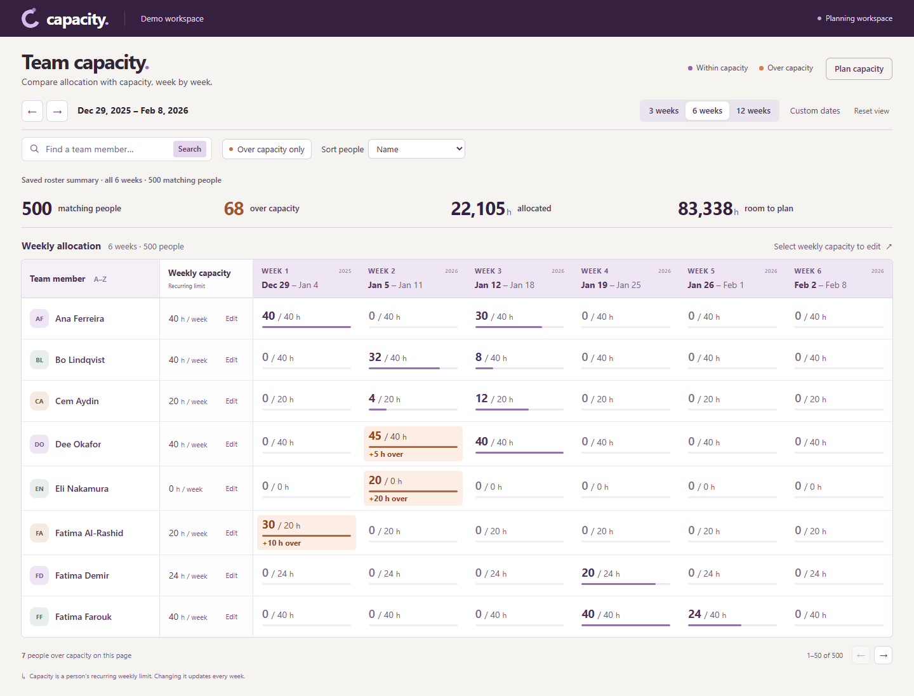

# Capacity Planner

A weekly planning workspace for finding overload and changing recurring capacity safely. Go and PostgreSQL provide the API; React and TypeScript provide the grid and scenario editor.



## Run

With Docker Compose v2 installed:

```sh
docker compose up --build
```

Open <http://127.0.0.1:4522>; API health is <http://127.0.0.1:4521/api/health>. Both published ports bind to loopback. The database has no host-published port. Fixture credentials in Compose are for this isolated local demo. `docker compose down` stops this project's containers. The schema and fictional seed are loaded when PostgreSQL initializes.

Alternatively, use PostgreSQL 17, Go 1.27, and Node.js 24. Create an empty database, apply `db/schema.sql` followed by `db/seed.sql` with `psql`, and set `DATABASE_URL` to its connection string. In `api/`, run `go run .`; in `web/`, run `npm ci` and `npm run dev`. Defaults are API 4521 and web 4522. `DATABASE_URL` is mandatory, and the standalone API defaults to loopback. Never use a production database for this demo.

## Two-minute tour

1. Search **Dee**. The January 5, 2026 week shows 45 allocated hours against a 40-hour limit. Open the person's allocation details to inspect project contributions.
2. Edit weekly capacity and reload to verify persistence. Open the same editor in two tabs before saving either to see a conflict instead of a silent overwrite.
3. Choose **Plan capacity**, stage changes, and compare the preview. **Apply plan** commits all changes atomically against the expected starting values.
4. Stage a change and refresh. **Restore draft** rechecks current values before you can apply. A browser draft expires after 24 hours; it never saves itself to the server.

Search, overload filtering, stable sorting, pagination, date bounds, project breakdowns, and zero-capacity cases all participate in the planning workflow. Capacity edits change recurring limits rather than reallocating project work. The seed contains 500 fictional people and 12 projects.

## What to inspect

- [Architecture](docs/ARCHITECTURE.md): state and data flow.
- [API contracts](docs/API.md): bounded reads, compare-and-swap writes, and atomic scenario application.
- [Decisions](DECISIONS.md): original implementation tradeoffs, preserved as historical context.
- `api/`: SQL aggregation and transactional mutation boundaries.
- `web/src/`: editing, stale-response handling, conflict resolution, scenario drafts, and recovery.

## Verify

With `DATABASE_URL` pointing to the isolated demo database:

```sh
# api/
go test ./... -count=1
go vet ./...
# web/
npm ci
npm test
npm run build
```

The database-backed tests use rolled-back transactions; frontend tests cover drafts, recovery, conflicts, and obsolete responses. CI runs both layers with PostgreSQL. The local app has no authentication and is intended for isolated demonstrations.

## Project context

Kallas Lima implemented this planning workflow on a supplied assessment scaffold. This edition preserves the original schema, seed, and decision record, with updated dependencies, explicit database configuration, HTTP timeouts, clearer health errors, local-only service bindings, accessibility adjustments, and current documentation. The original submission and deployed resources remain separate.
