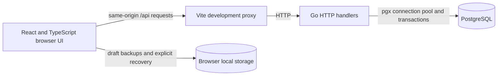

# Architecture

This assignment keeps one React client, one Go API, and one PostgreSQL database.
The supplied Compose environment runs all three; there is no additional service.

## Source map

| File                                                              | Responsibility                                                               |
| ----------------------------------------------------------------- | ---------------------------------------------------------------------------- |
| [web/src/CapacityGrid.tsx](../web/src/CapacityGrid.tsx)           | Range, search, priority controls, pagination, and table composition          |
| [web/src/useCapacity.ts](../web/src/useCapacity.ts)               | Server snapshots, request cancellation, individual saves, reconciliation     |
| [web/src/CapacityEditor.tsx](../web/src/CapacityEditor.tsx)       | Local input draft, validation, conflict choice, keyboard recovery            |
| [web/src/useCapacityPlan.ts](../web/src/useCapacityPlan.ts)       | Browser-local scenario drafts and atomic apply lifecycle                     |
| [web/src/planStorage.ts](../web/src/planStorage.ts)               | Versioned draft validation, expiry, per-plan backups, and recovery ownership |
| [web/src/PlanRecovery.tsx](../web/src/PlanRecovery.tsx)           | Explicit restore/discard choice and recovery/storage feedback                |
| [web/src/CapacityPlanPanel.tsx](../web/src/CapacityPlanPanel.tsx) | Proposed changes and before/after impact review                              |
| [web/src/AllocationCell.tsx](../web/src/AllocationCell.tsx)       | Allocation ratio, visual meter, and overload exception                       |
| [web/src/AllocationDetails.tsx](../web/src/AllocationDetails.tsx) | Read-only weekly project breakdown in a native dialog                        |
| [web/src/capacity.ts](../web/src/capacity.ts)                     | Shared response types, calendar formatting, and input parsing                |
| [api/main.go](../api/main.go)                                     | HTTP routes and database connection pool                                     |
| [api/capacity.go](../api/capacity.go)                             | Range validation and roster-wide weekly aggregation                          |
| [api/people.go](../api/people.go)                                 | Individual compare-and-set capacity updates                                  |
| [api/plan.go](../api/plan.go)                                     | Atomic multi-person capacity changes                                         |
| [api/allocations.go](../api/allocations.go)                       | Person/week project contribution queries                                     |

Paths above are relative to the repository root. The API and hooks own data rules;
components own presentation and interaction state.

## Reading capacity

`GET /api/capacity` normalizes selected dates to complete Monday–Sunday weeks.
Assignments contribute on inclusive Monday–Friday dates. Distinct source records
remain additive, including records with equal-looking dates and daily hours.

The query searches names, scores each matching person across the selected weeks,
filters overloads, orders results, and only then selects the requested roster page.
This makes priority and summaries independent of which page is visible. Summaries
describe the entire eligible roster; the footer separately describes the shown page.

The UI requests 50 people at a time. The API allows at most 100 people per page and
106 weeks per request. Paging bounds client rendering, while global prioritization
still requires database work across the matching roster. The database request has
a five-second context deadline; realistic concurrent load remains unmeasured.

## Saving one capacity

The editor preserves its input separately from the saved person. A PATCH sends both
the proposal and the capacity observed when editing began. The API changes the row
only when that expected value still matches, or confirms success if the desired
value is already stored. A conflict returns the canonical person for explicit review.

Confirmed changes update every displayed week. Priority views reload because the
person's membership or ordering may change; an emptied last page moves to a valid
page. A lost response can follow a committed write, so retry and Cancel/Escape
reconcile with the server rather than assuming the old value remains authoritative.

## Previewing a scenario

Staging changes the preview without writing capacity to the server. Drafts retain
each person's original expected capacity across restaging and roster pages.
Projected rows use proposed limits; the saved roster summary continues to describe
the server baseline.

Starting a plan preserves its search, status, order, and page. Those controls continue
to use saved capacities, so draft edits do not silently remove or reorder people.
Dates remain locked to the plan's range. The allocation drawer stays available and
separates the saved weekly limit from any staged limit, including zero.

Apply sends one batch of 1–100 changes. PostgreSQL locks the affected rows in stable
ID order, checks every expected value, and commits all updates together. Conflicts
apply nothing and require another explicit review. An unconfirmed apply freezes
draft edits/removal so an identical retry can safely confirm the desired values.
Closing refreshes canonical data.

## Recovering a local draft

The hook also backs up nonempty drafts through `planStorage.ts`. Versioned local-storage
records validate the full query and draft payload, expire 24 hours after their last
save, and use separate IDs for independent plans. Expiry is checked again when Restore
starts and after its capacity reads finish. They contain no server-side draft
or shared-editing model.

Recovery is an explicit UI choice. Before restoring, the hook reads canonical
capacities through the existing allocation endpoint in bounded batches. Ordinary
drafts retain proposals and refresh expected values; a changed baseline requires
review before apply. The original query context is restored alongside the plan.

An in-flight apply is backed up as uncertain before its PATCH begins. Recovery keeps
that original payload unchanged so retry can confirm a potentially committed write.
Restoring forks a new plan ID and marks only the source revision consumed, protecting
an unrelated or duplicated tab's backup. Storage failures produce a warning while
the in-memory workflow remains available. Drafts are browser-local, not collaborative.

## Late responses and boundaries

Load requests carry a selection key and sequence number; obsolete requests are
aborted and rejected. Mutation versions prevent an older response from replacing a
newer confirmed save. The allocation dialog independently cancels obsolete week loads.
Native table/dialog semantics, accessible labels, and deliberate focus restoration
support the same flows through keyboard interaction.

The fixed schema stores one recurring capacity per person, so edits affect past and
future weeks. It cannot express effective dates, leave calendars, or scenario history.
The scaffold has no authentication and is intended for local evaluation. The supplied
schema, seed, Compose file, Dockerfile, and Makefile remain unchanged.

See [API and behavior reference](API.md) for payloads and recovery contracts, and
[Decisions](../DECISIONS.md) for the tradeoffs and future direction.
